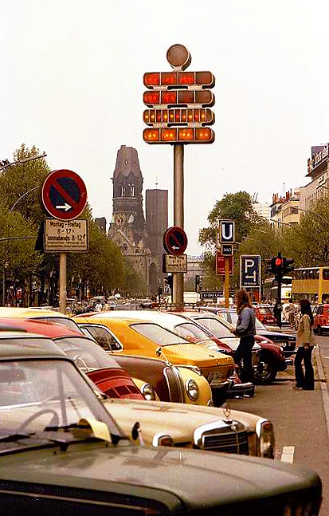
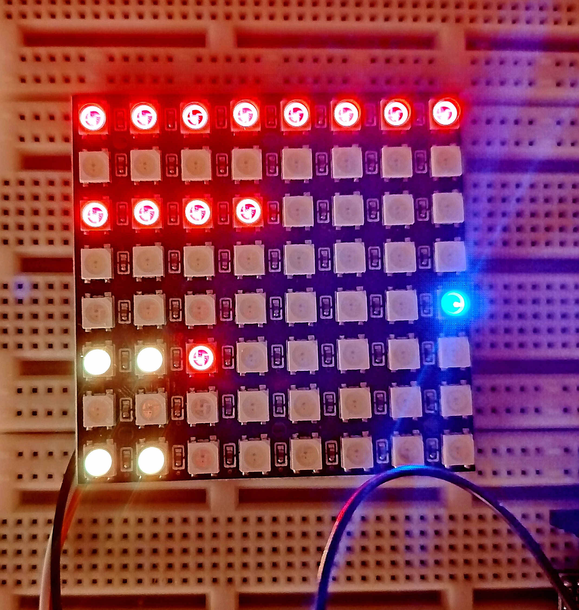

# [Berlin-Uhr](https://de.wikipedia.org/wiki/Berlin-Uhr)

Der Uhrmacher und Elektroingenieur [Dieter Binninger](https://de.wikipedia.org/wiki/Dieter_Binninger) hat 1975 die erste Uhr der Welt, die die Zeit mit leuchtenden farbigen Feldern anzeigt, mitten auf dem Kurfürstendamm in Berlin aufstellen lassen. 


*Foto: [Willy Pragher](http://www.landesarchiv-bw.de/plink/?f=5-786660) / [CC BY 3.0](https://creativecommons.org/licenses/by/3.0/de/)*

Viele kannten diese Uhr unter dem Namen _Mengenlehre-Uhr_, obwohl sie mit der damals im Schulunterricht noch sehr kritisch gesehenen Mengenlehre gar nichts zu tun hat. Und die wenigsten haben verstanden, wie man auf dieser Uhr die Zeit ablesen soll. Trotzdem ist sie ein Wahrzeichen (gewesen). Auch heute noch ist die [Berlin-Uhr](https://de.wikipedia.org/wiki/Berlin-Uhr) zu bestaunen, wenn auch an einem deutlich weniger prominenten Standort.

Es gab in den Berliner Souvenirläden auch ein Tischmodell dieser Uhr zu kaufen - und darin arbeitet auch heute noch ein [TMS1000](https://de.wikipedia.org/wiki/Texas_Instruments_TMS1000) von Texas Instruments. Welcher Chip in der großen Original-Uhr eingesetzt wurde, ist mir leider nicht bekannt, aber 1975 war die Auswahl an Microcontrollern nicht allzu groß, also darf spekuliert werden... In jedem Fall schließt sich hier der Kreis, denn der größere Bruder TMS1600 verrichtet immer noch zuverlässig seine Dienste im Microtronic.



Der Microtronic kann jetzt auch Berlin-Uhr! Wer kann die richtige Uhrzeit erkennen? 

Das [Berlin-Uhr-Microtronic-Programm](https://github.com/rab-berlin/ESP2090/blob/main/program/berlinuhr/berlin.mic) dazu ist einfach. 

Alles, was auf der LED-Matrix angezeigt werden soll, befindet sich in den Speicherregistern 0-F. Ein gesetztes Bit bedeutet, dass die entsprechende LED leuchtet, ein nicht gesetztes Bit lässt die LED ausgeschaltet. Im Unterprogramm _Frame_ werden die Werte in den Speicherregistern schnell hintereinander auf die Ausgänge gelegt. Der ESP liest diese Werte und steuert die LED-Matrix entsprechend. Für ein genaues Timing gibt es noch ein REQ-Signal vom ESP und ein ACK-Signal vom Microtronic.

```

Frame      DIN REQ-ACK-CLEAR           Auf REQ warten

&#x20;          ANDI #1,REQ-ACK-CLEAR       .

&#x20;          BRZ Frame                   .

&#x20;          DOT REQ-ACK-CLEAR           ACK senden

&#x20;          EXRL                        Speicherregister 0-7 in Arbeitsregister holen

&#x20;          DOT r0                      Alle Register 0-F als Nibble senden

&#x20;          DOT r1                      .

&#x20;          DOT r2                      .

&#x20;          ...                         .

&#x20;          DOT rF                      .

&#x20;          EXRL                        Speicherregister 0-7 wieder zurück

&#x20;          MOVI #0,REQ-ACK-CLEAR       Null auf Ausgänge legen

&#x20;          DOT REQ-ACK-CLEAR           .

&#x20;          RET	

```

Standard ist übrigens, dass alle LEDs nur rot leuchten. Man kann dem ESP2090-Studio über ein User-Skript [farbmatrix.py](https://github.com/rab-berlin/ESP2090/blob/main/program/berlinuhr/farbmatrix.py) allerdings vorher mitteilen, welche Farbe jede einzelne LED der Matrix annehmen soll, wenn sie eingeschaltet wird. Dann wird's schön bunt.

Im Hauptprogramm wird die Zeit mit TIME aktualisiert, dementsprechend die einzelnen Speicherregister mit Werten gefüllt und schließlich das Unterprogramm aufgerufen, um den Frame zu übermitteln. 

Ohne ESP2090-Studio und LED-Matrix wirkt das Programm allerdings (optisch) wenig ansprechend: Das Display wird abgeschaltet und danach passiert nix mehr, weil der Microtronic genauso verzweifelt wie vergeblich auf das REQ-Signal wartet. 

Wer's ohne ESP2090-Studio prinzipiell mal testen will, muss einen Taster korrekt am Eingang 1 anschließen und kann dann verfolgen, wie der Microtronic bei jedem Tastendruck einen Frame über die Ausgänge sendet.

